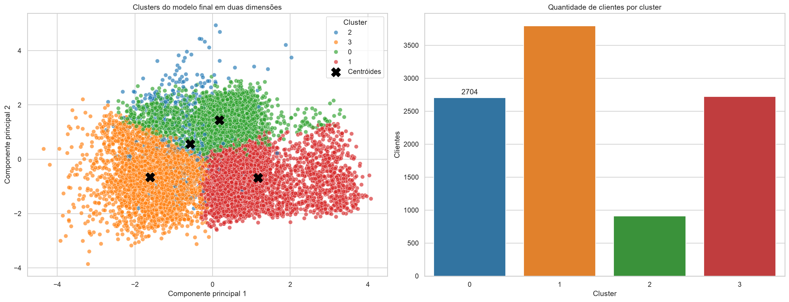
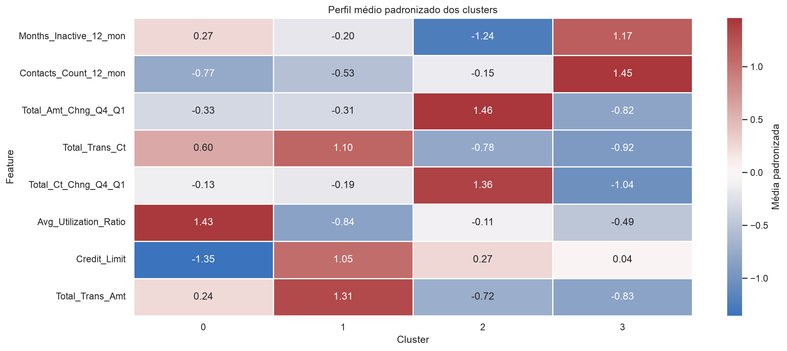
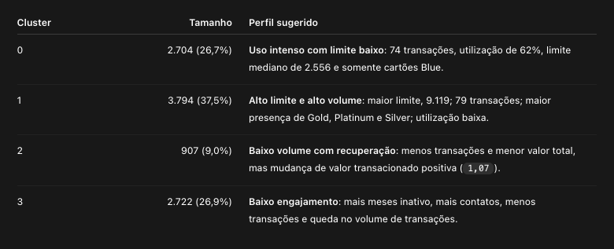
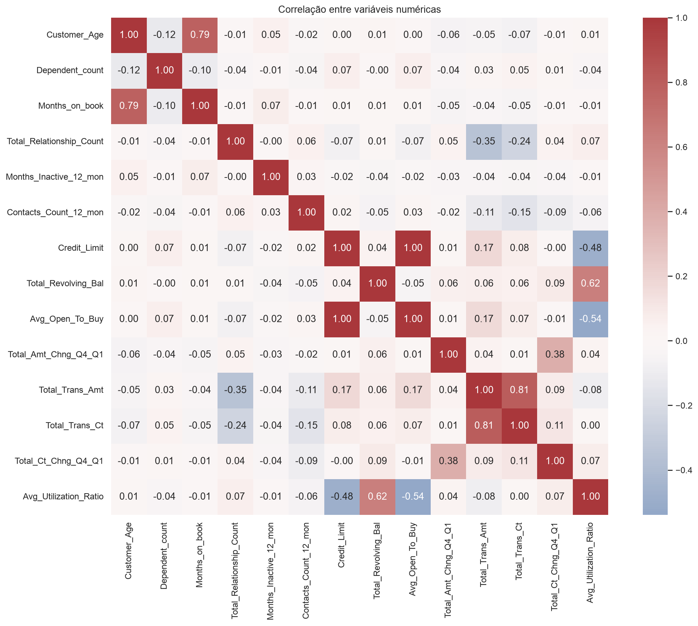
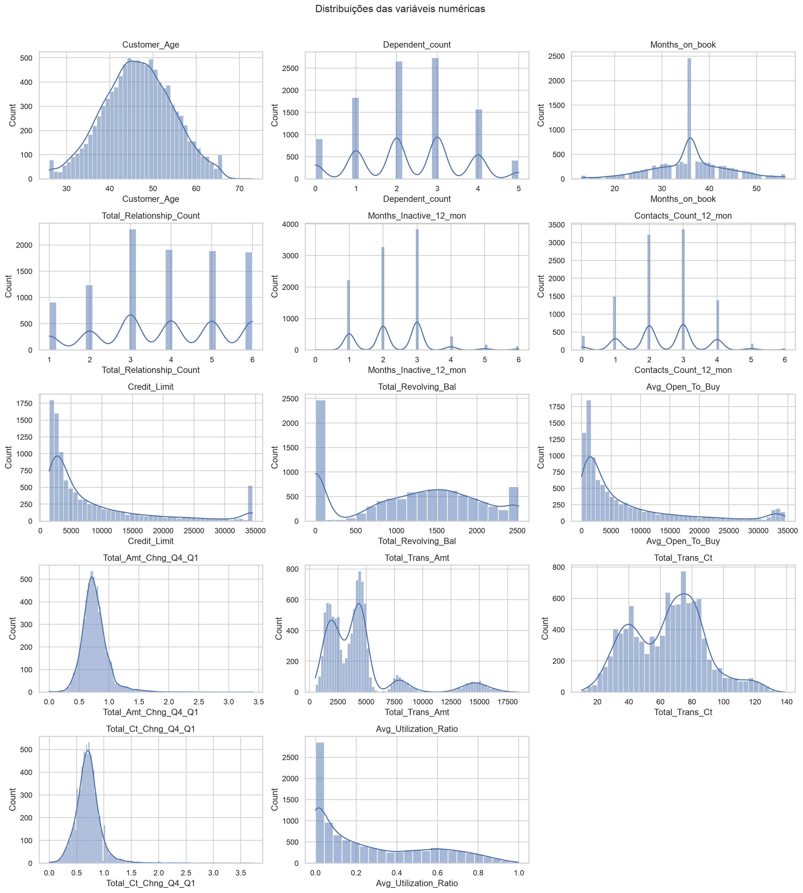
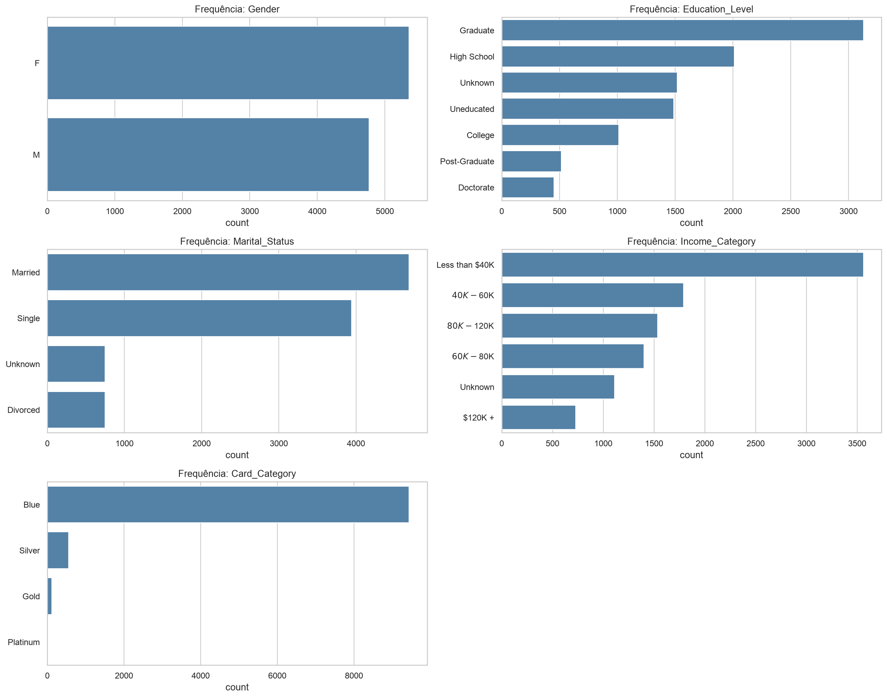

# Model Card Clusters

Projeto de segmentação de clientes de cartão de crédito usando aprendizado não supervisionado. O objetivo é transformar os dados de comportamento dos clientes em grupos interpretáveis, permitindo comparar perfis de uso, tamanho dos segmentos e características médias de cada cluster.

## Objetivos

- Preparar a base de clientes para análise de clustering.
- Comparar configurações de KMeans e clustering hierárquico.
- Registrar experimentos, parâmetros e métricas no MLflow.
- Treinar um modelo final com quatro clusters.
- Gerar visualizações para interpretar a separação e o perfil dos clusters.

## Dados

A base original está em `data/raw/BankChurners_clusterizacao.csv`. O fluxo gera dois arquivos intermediários:

| Arquivo | Descrição |
| --- | --- |
| `data/interim/BankChurners_clean.parquet` | Dados sem linhas duplicadas |
| `data/processed/ABT.parquet` | Base analítica usada no treinamento |

A ABT contém 10.127 registros e é carregada por `src/training/load_date.py`.

## Features usadas

O pipeline seleciona as seguintes variáveis:

- Numéricas: `Months_Inactive_12_mon`, `Contacts_Count_12_mon`, `Total_Amt_Chng_Q4_Q1`, `Total_Trans_Ct`, `Total_Ct_Chng_Q4_Q1` e `Avg_Utilization_Ratio`.
- Transformadas com `log1p`: `Credit_Limit` e `Total_Trans_Amt`.
- Categórica: `Card_Category`.

O pré-processamento aplica `StandardScaler` às variáveis numéricas, `log1p` seguido de padronização às variáveis de escala e `OneHotEncoder` à categoria do cartão.

## Modelo final

O modelo final é um `KMeans` configurado com:

```text
n_clusters = 4
init = k-means++
n_init = 20
random_state = 42
```

O modelo é encapsulado em um pipeline do scikit-learn, com o pré-processamento e o clusterizador na mesma sequência. Isso mantém a transformação aplicada aos dados consistente com a usada durante o treinamento.

## Avaliação

Os experimentos calculam:

- Silhouette Score: avalia coesão e separação dos clusters; valores maiores são melhores.
- Davies-Bouldin Score: compara similaridade entre clusters; valores menores são melhores.
- Calinski-Harabasz Score: mede a razão entre dispersão entre grupos e dentro dos grupos; valores maiores são melhores.

O script `src/evaluation/profile_clusters.py` também imprime o tamanho de cada cluster, as medianas das features numéricas e a distribuição de `Card_Category` por cluster.

## Visualizações do modelo final

O script `src/evaluation/visualize_clusters.py` treina o modelo final e gera:

1. Um gráfico de dispersão em duas dimensões usando PCA, com os clientes coloridos por cluster e os centróides destacados.
2. Um gráfico de barras com a quantidade de clientes em cada cluster.
3. Um heatmap com o perfil médio padronizado das features numéricas por cluster.

Para exibir os gráficos:

```bash
python src/evaluation/visualize_clusters.py
```

### Imagens do modelo

As figuras abaixo são geradas pelo script de visualização e salvas em `reports/model/`.





### Perfis sugeridos para os clusters

A tabela abaixo resume uma interpretação de negócio para cada grupo identificado pelo modelo:



- Cluster 0: uso intenso, com limite baixo e utilização elevada.
- Cluster 1: clientes de alto limite e alto volume de transações.
- Cluster 2: baixo volume, mas com recuperação positiva na mudança do valor transacionado.
- Cluster 3: baixo engajamento, com mais meses de inatividade e menos transações.

### Imagens da análise exploratória

Alguns resultados da análise exploratória estão disponíveis em `reports/eda/`.







## Como executar

### 1. Criar o ambiente

```bash
python3.11 -m venv .venv
source .venv/bin/activate
pip install -r requirements.txt
```

### 2. Preparar os dados

```bash
python src/preprocessing/clean.py
python src/features/build_abt.py
```

### 3. Explorar a base

```bash
python nootbooks/Eda.py
```

Os resultados exploratórios são salvos em `reports/eda/`.

### 4. Comparar modelos

```bash
python src/training/train.py
```

Esse treinamento avalia configurações de KMeans e `AgglomerativeClustering` e registra os resultados no experimento `model-card-clusters` do MLflow.

### 5. Treinar o modelo final

O script final registra o pipeline no MLflow usando o nome `kmeans_final`:

```bash
python src/training/train_final_model.py
```

Esse script espera o MLflow disponível em `http://127.0.0.1:5000/`.

### 6. Inspecionar os clusters

```bash
python src/evaluation/profile_clusters.py
python src/evaluation/visualize_clusters.py
```

## Estrutura principal

```text
model-card-clusters/
├── data/
│   ├── raw/
│   ├── interim/
│   └── processed/
├── nootbooks/
│   └── Eda.py
├── reports/eda/
├── reports/model/
├── src/
│   ├── evaluation/
│   ├── features/
│   ├── preprocessing/
│   └── training/
├── requirements.txt
└── README.md
```

## Tecnologias

- Python 3.11
- pandas e NumPy
- scikit-learn
- Matplotlib e Seaborn
- MLflow
- Parquet via PyArrow

## Limitações

Este projeto realiza segmentação exploratória e não possui uma variável-alvo supervisionada. Os clusters representam padrões estatísticos da base e devem ser interpretados junto com as métricas, os perfis gerados e o contexto de negócio.
